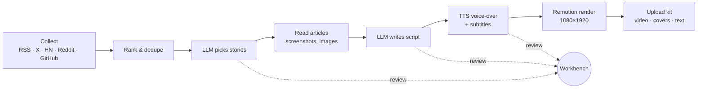

# auto-news-shorts

**Turn the day's AI and tech news into a vertical short video, with almost every step free.**

[中文说明](README.zh-CN.md)

auto-news-shorts collects news from dozens of sources, has an LLM pick the stories and write the script, voices it with a free TTS engine, and renders a 1080×1920 video with Remotion. At the end you get an **upload kit**: the video, covers, title, description, tags and chapter list, ready to post by hand on Bilibili, Douyin, Kuaishou, WeChat Channels, YouTube Shorts and similar platforms.

The generated videos are in **Chinese**. The pipeline, prompts and default sources are built for Chinese-language AI news channels.

## Highlights

1. **Almost entirely free.** Only the script-writing LLM costs money; with DeepSeek that is a few cents per episode. Voice-over runs on Edge TTS, Qwen3-TTS or GPT-SoVITS, rendering on Remotion and ffmpeg, all free.
2. **Many sources.** Official X accounts, company blogs, tech media, Hacker News, Reddit, GitHub Trending, Hugging Face and Techmeme. Sources and topic rules are plain config.
3. **One command, or step by step.** `npm run daily` goes from collection to finished video. The local workbench lets you stop after each stage to review topics, edit the script, re-record single sentences and preview frames.
4. **Lessons from real use.** [Troubleshooting](docs/troubleshooting.md) covers production problems we actually hit. [Publishing guide](docs/publishing-guide.md) explains how auto-upload can be done and where it breaks; the guide includes no upload code.

## What it costs

| Step | Tool | Cost |
|---|---|---|
| Collect news | RSS, public APIs, [OpenCLI](https://github.com/jackwener/OpenCLI) for X / Reddit (optional) | Free |
| Pick stories, write script | Any OpenAI-compatible LLM (default: [DeepSeek](https://api-docs.deepseek.com)) | Pay per use, about ¥0.1–0.5 per episode |
| Check pictures | A vision model (default: DeepSeek `deepseek-flash`, same key) | Pay per use, small |
| Translate candidates for review | Bing web translator | Free |
| Voice-over | [Edge TTS](https://github.com/rany2/edge-tts) (default) / [Qwen3-TTS](https://github.com/QwenLM/Qwen3-TTS) / [GPT-SoVITS](https://github.com/RVC-Boss/GPT-SoVITS) | Free (the last two need an NVIDIA GPU) |
| Render | [Remotion](https://www.remotion.dev) + [ffmpeg](https://ffmpeg.org) | Free for individuals ([Remotion license](https://www.remotion.dev/docs/license)) |
| Upload | Done by hand (see the publishing guide) | Free |

## How it works



Two columns (shows) ship by default:

- **news**: a daily AI news roundup with 4–6 stories. It only collects news published since the previous episode.
- **github**: a weekly roundup of trending AI open-source projects. Repos featured in the last 8 weeks are skipped.

## Quick start

Windows 11 is the tested platform. macOS and Linux should mostly work but are untested.

```bash
git clone https://github.com/KoroLiu/auto-news-shorts.git
cd auto-news-shorts
npm ci
npm run setup
```

`npm run setup` checks Node, ffmpeg, Chrome/Edge and Python, installs `edge-tts` into that Python, and makes a test voice clip. Fix anything it marks with ❌; [docs/setup.md](docs/setup.md) explains each item.

Give the pipeline an LLM key. Copy `.env.example` to `.env` and fill in:

```
LLM_API_KEY=sk-...
```

The default endpoint is DeepSeek (`https://api.deepseek.com`): `deepseek-flash` writes the scripts and also checks the pictures (`LLM_VISION_MODEL`), which drops stock photos and unrelated screenshots. Set `LLM_MODEL=deepseek-v4-pro` for the larger model; it costs several times more per token. Any OpenAI-compatible service works; set `LLM_BASE_URL`, `LLM_MODEL` and `LLM_VISION_MODEL` for another one. Leave `LLM_VISION_MODEL` empty if it has no vision model.

Then make an episode:

```bash
npm run daily -- --auto
```

`--auto` runs straight through without stopping for review. The result lands in `runs/<date>-news/package/`:

```
video.mp4            1080×1920 video
cover-landscape.jpg  16:9 cover
cover-portrait.jpg   3:4 cover
metadata.txt         title (plus shortened titles per platform), tags, chapters, description
metadata.json        the same, machine-readable
```

To review each stage instead, open the workbench:

```bash
npm run workbench
```

Prefer to let an AI coding agent set it up? Point Claude Code, Codex or a similar agent at [`skills/auto-news-shorts/SKILL.md`](skills/auto-news-shorts/SKILL.md). It walks the agent through installing, configuring and troubleshooting on your machine.

## Commands

| Command | What it does |
|---|---|
| `npm run setup` | Check and prepare the environment |
| `npm run workbench` | Open the local review workbench (http://127.0.0.1:3220) |
| `npm run daily` | Make today's news episode (stops for review; add `-- --auto` to run through) |
| `npm run weekly` | Make this week's GitHub-projects episode |
| `npm run studio` | Open Remotion Studio to tweak the video template |
| `npm test` / `npm run check` | Unit tests / type check |
| `npm run audit` | Privacy check before you publish a fork (see [AGENTS.md](AGENTS.md)) |

## Scope and limits

- **Vertical first.** The maintained template is 1080×1920 (Remotion). An older 1920×1080 template (`render.engine: "chrome"`) is still included but not maintained and may need fixes.
- **No upload code.** The pipeline stops at the upload kit. Automating uploads carries account risk and platform rules change often; see [docs/publishing-guide.md](docs/publishing-guide.md).
- **X and Reddit are optional.** They are read through your own logged-in Chrome via OpenCLI. Without it those sources are skipped and everything else still works.
- **Human review is recommended.** The editor prompts require official or first-hand sources and check that every number in a title appears in the source text. The AI can still be wrong; read the script before you publish.
- **Political stories are flagged, not dropped.** With `select.politicsFilter` on (the default), they stop at topic review for you to decide.

## Your own host and cover character

The video and covers show a host. This repo ships only a neutral placeholder silhouette. To use your own character, see [docs/custom-host.md](docs/custom-host.md).

> ⚠️ Only use artwork you made yourself, own the rights to, or have a license for. Characters from games, anime or other media are usually copyrighted; publishing videos with them is your own responsibility.

## Docs

- [Setup](docs/setup.md): every dependency, where to get it, how to verify it
- [Configuration](docs/configuration.md): `config.json`, `config.local.json`, environment variables
- [Sources](docs/sources.md): adding, removing and tuning news sources
- [Custom host](docs/custom-host.md): replacing the placeholder character
- [Troubleshooting](docs/troubleshooting.md)
- [Publishing guide](docs/publishing-guide.md): uploading, with no code included

## License

[MIT](LICENSE) for this project's own code. Third-party tools keep their own licenses. That includes [Remotion](https://www.remotion.dev/docs/license), which requires a company license for some organizations, as well as the TTS engines, OpenCLI and the news sites you collect from. Respect each site's terms and copyright when you reuse their content.
